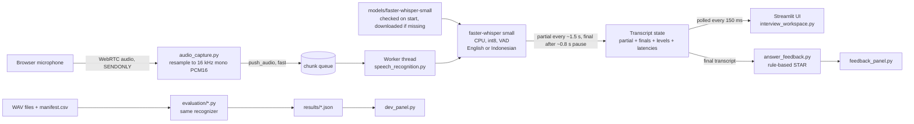

# System architecture

**Threads.** The WebRTC thread only converts audio and enqueues it, so it never blocks on the model.
One worker thread per attempt runs inference. The Streamlit script thread only reads snapshots.

**Partial transcription.** Both languages use faster-whisper-small; the language code selects English or Indonesian.
Whisper is not a streaming model, so the recognizer buffers the incoming audio and re-decodes the buffer since the last pause
every 1.5 s, which updates the partial text while the user is still speaking. A pause of about 0.8 s, or 12 s of continuous
speech, finalizes the segment and starts a new buffer. Silence is never decoded (a loudness gate plus faster-whisper's voice
activity filter), because Whisper invents text when given silence. If the worker falls behind (more than ~0.5 s of queued audio),
partial decodes are skipped until it catches up, so the queue does not grow. Audio is processed continuously during speech and
no complete recording is needed first, but updates arrive in chunks, not word by word, and earlier words can change when a
later chunk is decoded.

**Latency (live app).** Time from `push_audio` of a chunk to the transcript text changing because of that chunk
(queue wait + inference). Browser capture, WebRTC transport and rendering are excluded.
**Latency (offline script).** Per-chunk `feed()` time, time-to-first-partial, final-flush delay and real-time factor.
