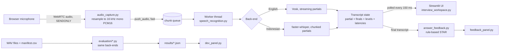

# System architecture

**Threads.** The WebRTC thread only converts audio and enqueues it, so it never blocks on the model.
One worker thread per attempt runs inference. The Streamlit script thread only reads snapshots.

**Partial transcription.** English: Vosk returns `PartialResult()` after every ~100 ms chunk.
Indonesian (Whisper): the buffer since the last pause is re-decoded every 1.5 s; a 0.8 s pause finalizes it.

**Latency (live app).** Time from `push_audio` of a chunk to the transcript text changing because of that chunk
(queue wait + inference). Browser capture, WebRTC transport and rendering are excluded.
**Latency (offline script).** Per-chunk `feed()` time, time-to-first-partial, final-flush delay and real-time factor.
